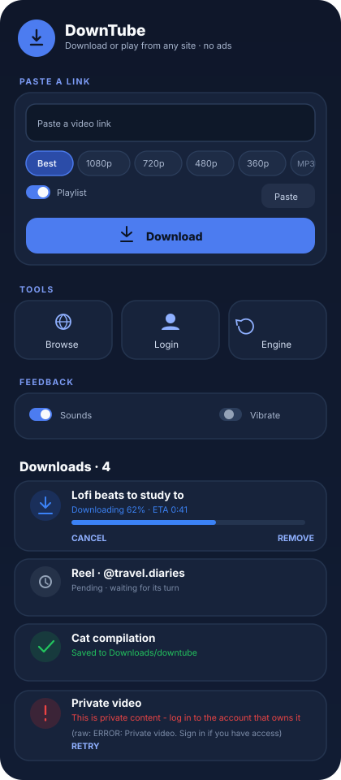

# DownTube

[](LICENSE)
[](https://github.com/asu-dev-ai/DownTube/actions/workflows/android.yml)
[](https://github.com/asu-dev-ai/DownTube/releases)
[](#install)

A free **Snaptube-style** downloader for Android. Paste or copy any video link, pick a
quality, download — or browse, play and save straight from the app.

**No ads · no account · no tracking · MIT licensed** — fork it, change it, ship it.



> Design mockup of the main screen: sectioned layout, three tool tiles and the
> download list with its status badges — downloading, pending, complete and failed.

## Install

1. Open [Releases](https://github.com/asu-dev-ai/DownTube/releases) — tagged builds ship
   both APKs attached — or the latest green run on [Actions](../../actions/workflows/android.yml)
   under *Artifacts*.
2. Download `downtube-release-apk` (or `debug`), unzip, copy the `.apk` to your phone.
3. Tap it and allow *Install unknown apps*.

| | |
|---|---|
| **Requires** | Android 10 (API 29) or newer |
| **Size** | ~97 MB per APK — Python, yt-dlp and ffmpeg are bundled inside |
| **ABI** | arm64-v8a + armeabi-v7a |

## What is inside

### Downloading
- **Queue** with five states, each with its own icon, colour and wording:
  **pending → downloading → complete / failed / cancelled**
- Live **progress % + ETA**, per-item **Cancel**, **Retry** (resumes), **Remove**
- **Foreground service** — downloads keep running with a notification and a
  Cancel action when the app is in the background
- **Playlist** support (switch next to the quality chips)
- Files land in **`Downloads/downtube`**, visible in the gallery and file manager
- **Sound + vibration** on queue/complete/fail, both switchable in the app
- Friendly, actionable errors instead of yt-dlp trace text
  (login needed, 404, rate limited, out of storage, unsupported link, …) — with the
  raw engine line shown underneath so a failure can actually be diagnosed
- **Engine self-refresh** — the yt-dlp bundled in the APK is refreshed from the
  nightly channel before the first download of a session (at most once every 3 days).
  This is what keeps YouTube extraction working after the site changes; the
  **Engine** tile forces a refresh at any time

### Browse, play, download
- **In-app browser** — open any site, play the video inline, tap *Download this page*
- **Login** mode saves the site's cookies so private/login-walled links work
- **Clipboard auto-detect** — copy a link in another app, open DownTube, and a popup
  offers **Play / Download / Close**; back button or *Close* dismisses it
- **Platform detection** — the popup labels YouTube, Instagram, Facebook, TikTok,
  X/Reddit, SoundCloud, Vimeo, Dailymotion, Twitch, Tumblr, Bilibili, …
- **Built-in player** (Media3/ExoPlayer): seek, play/pause, **speed 0.5x–2x**, mute
- **Engine** tile pulls the newest yt-dlp nightly on demand

### Quality presets
Best · 1080p · 720p · 480p · 360p · **MP3** (192 kbps)

## Platforms

Download support comes from [yt-dlp](https://github.com/yt-dlp/yt-dlp) —
**1755 extractors**. Realistically:

| Works without login | Needs *Login* (cookies) first | Not supported |
|---|---|---|
| YouTube, TikTok, Reddit, Pinterest, SoundCloud, Vimeo, Dailymotion | Instagram, Facebook, X/Twitter, private/unlisted/age-gated content | Threads (no extractor), DRM content |

If a download says *"This site needs a login"* — tap **Login**, sign in in the browser,
tap **Use cookies**, retry.

## Building

Everything runs on GitHub — no local toolchain needed:

- Push to `main`, open a PR, or run the workflow manually → **debug + release APKs**
  are built and uploaded as artifacts
- Push a tag (`v1.0.0`) → both APKs are attached to a **GitHub Release** automatically

Locally (optional): `cd android && ./gradlew assembleDebug assembleRelease`.
The release APK is signed with the debug keystore so it installs without secrets —
fine for sideloading, not a Play Store setup.

### Project layout

```
android/        Android app (Kotlin, Material 3, youtubedl-android + Media3)
docs/           UI mockup
downtube.py     optional PC command line version
```

## Known limits

- yt-dlp ages fast against YouTube's changes. The app refreshes it automatically every
  3 days and before the first download of a session, but a brand-new site break can
  still land before a fixed yt-dlp build exists — tap **Engine** to force the pull
- Downloads survive the app going to the background, but a force-stop still kills them
- Not yet tested on a physical device (CI builds and packages the APK)

## Legal

Only download what you have the right to download. Downloading copyrighted material
usually breaks the site's terms of service and can be illegal where you live.

## [LICENSE](LICENSE) — MIT
